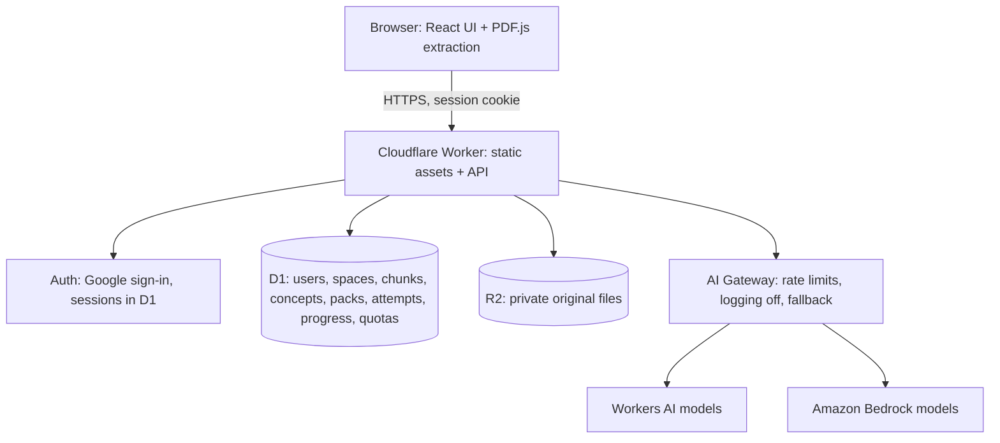

# Architecture

**Decision (6 October 2026):** TAI runs on Cloudflare. Learners sign in (no guest mode). One Cloudflare Worker serves the web app and a JSON API; D1 is the single learner database; R2 holds original files; AI Gateway fronts the model providers (Workers AI and Bedrock), chosen by measured quality. Full offline mode remains deferred to P1. This replaces the earlier local-first, stateless-endpoint design and the AWS Lambda/SAM hosting plan.

## System view

One deployable Worker, one database, one bucket. No queue, no job workers, no outbox or sync layer: with offline deferred, the browser is a plain client of the API.

## Responsibilities

| Boundary | Responsibilities |
| --- | --- |
| Browser | Sign-in UI; local PDF/TXT validation (10 MB, 50 pages) and PDF.js extraction into page-aware chunks; rendering with safe KaTeX; local MCQ and numeric checks for instant feedback; unsent answer draft kept in local storage until the server acknowledges it |
| Worker API | Session check on every route; ownership-scoped CRUD; request validation (Zod); per-user AI quotas; server-side re-check of MCQ and numeric outcomes before recording evidence; review dates and session selection via the shared domain module |
| Domain module (shared) | Exact MCQ grading, numeric tolerance/unit checks, evidence labels, review intervals, session budgets, return flow. Pure TypeScript used by both browser and Worker |
| D1 | Canonical store for all PRD entities plus users, sessions and quota counters |
| R2 | Original PDF/TXT files under owner-scoped keys; never public; served only through the Worker after an ownership check |
| AI adapter | Task kinds `concepts`, `pack`, `grade`, `followup`, `hint`, `explain_again`, `practical_task`; server-owned prompts; output schema and citation validation; provider routing per task |
| Resource catalog | Bundled checked links matched by concept tags |

PDF text extraction stays in the browser. Before storage, the Worker validates PDF structure, encryption status, and actual page count using pdf-lib; it does not extract PDF text or prove that submitted text matches the original. Structural validation still needs deployment CPU/memory evaluation on complex compressed documents.

## Identity and ownership

- Sign-in is required before creating a study space. Use Google OAuth through a Workers-compatible auth library storing users and sessions in D1 (Better Auth is the baseline; confirm in M0). Email sign-in is a later addition if needed.
- Sessions use Secure, HttpOnly, SameSite cookies. Mutations check origin.
- Every query filters by the server-resolved user ID. A study-space ID in a URL is never authorization. R2 keys are prefixed by user and space, and objects are streamed through the Worker after the same check.
- Collect only what sign-in needs (provider ID, email, display name). No school, age or other profile data.

## Ingestion and request flow

1. Learner signs in, creates a study space, selects a PDF/TXT. The browser validates size, type and page count, extracts chunks with stable IDs and offsets, and shows a preview with limitations (scanned, encrypted, garbled notation).
2. On confirmation, the browser uploads the original to the Worker (stored in R2) and the extracted chunks (stored in D1) in one material revision. The Worker re-checks size and type and caps chunk count and text size; it does not trust the browser's validation.
3. For AI tasks the browser sends only IDs (space, concepts, task kind). The Worker loads the relevant chunks from D1, so the browser never supplies source text for prompts and cannot inject arbitrary context.
4. The Worker checks the user's quota, calls the model through AI Gateway, validates schema and that every cited chunk ID belongs to the space's current revision, then stores the result in D1 and streams complete validated items to the browser.

## Teaching pipeline

The LLM does the teaching work; the application supplies memory, grounding and structure. Fixed task kinds, each with a schema, citation validation and input/output limits. This is not an autonomous agent: the application decides which stage runs and when.

| Stage | Task kind | When it runs | Output |
| --- | --- | --- | --- |
| Read | `concepts` | Once per selected section | Concepts with descriptions and source IDs |
| Write | `pack` | Per 3–5 question pack, plus at most one prefetch | Mixed recall, MCQ, explain, scenario and calculation items with keys/rubrics, explanations and source IDs |
| Grade | `grade` | Only for explain, scenario and calculation working | Supported/missing elements, rubric outcome or `uncertain`, source references |
| Follow-up | `followup`, `hint`, `explain_again` | After an incorrect/uncertain result, or on learner request | One targeted question, a hint, or an alternate explanation |

MCQ choices and numeric final answers never call the model. The browser checks them instantly; the Worker re-checks against the stored key before recording evidence. For calculations the number and the working are graded and stored separately; a correct number with flawed or uncertain working does not advance reasoning-based progress.

Generate calculation items only from sections whose extracted notation is readable or learner-corrected. Sending page-image crops to a vision model is an optional gated experiment, not P0.

## Packs, streaming and latency

A pack is one versioned JSON document in D1: pack ID, material revision, concepts, model/prompt/schema versions, 3–5 questions, keys or rubrics, explanations, cited source IDs and excerpts. Stream from the model through the Worker; emit only complete, validated items as typed `item`, `complete` or `error` events; never render partial JSON or leak answer keys before reveal.

Latency is dominated by model generation, not network distance. Measure time to first validated question, full-pack time and tokens/second per candidate model. Allow one next-pack prefetch while the learner studies; cancel it on topic change or session end. Answer keys are sent to the browser with the pack so feedback is instant; this is a learning tool, not a secure exam.

## Persistence and failure handling

- Submitting an answer writes the attempt and affected concept projections in one D1 batch, keyed by a client-generated attempt ID so a double-click or retry returns the original result instead of duplicating evidence.
- Attempt interactions are immutable D1 rows. The Worker hashes the canonical request, returns the prior response for an identical retry, rejects changed reuse, and reloads the current canonical question before grading. Normalized question-to-concept rows keep eligible evidence stable across ordinary pack changes; current material and concept revisions bound the projection.
- Until the server acknowledges an answer, the browser keeps the draft in local storage and offers explicit retry after a network failure. No background queue or replay.
- A dropped model stream keeps any items already validated and saved; the learner can retry the rest. A retry may cost another inference.

## Deletion

Deleting a study space first marks it deleted so reads and new uploads fail. Cleanup then removes material rows and R2 originals. D1/R2 are not one transaction: registered upload writers must settle before deletion returns complete. Pending cleanup returns an explicit retry state and retains a minimal ledger; there is no background deletion queue. A minimal owner/space tombstone prevents late requests from recreating data. Deleting the account removes all spaces, sessions and the user row. Deletion does not retract text already sent to a model provider; disclose this. Enable AI Gateway settings that avoid storing prompt/response bodies, and do not log learner text in the Worker.

## Abuse and spend controls

Signed-in users make per-user quotas possible: daily limits on packs, grading calls and prefetches, stored as counters in D1 and checked before every model call. Add AI Gateway rate limits as a second layer, keep an operator kill switch (environment flag), and cap input/output tokens per task. Billing alerts are visibility, not a hard cap.

## Future extension boundary

Full offline mode (service worker, pinned packs, local progress queue) remains P1. Self-contained pack JSON keeps it feasible later; it would add sync work that this design deliberately avoids for now.
