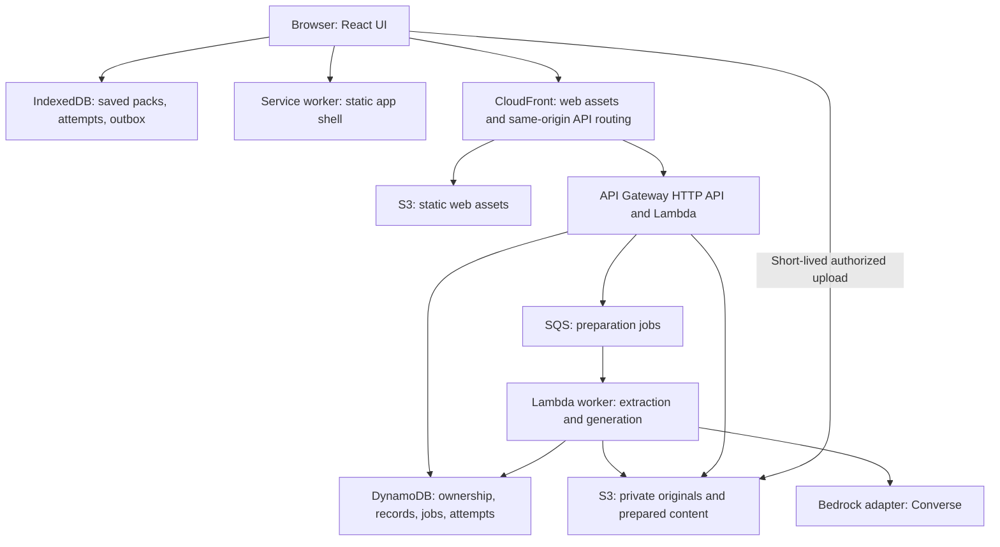

# Proposed architecture

TAI will be a small TypeScript web application with a server-side API and background preparation worker. One codebase contains domain modules and adapters; this is not a microservice platform. Bedrock is the preferred AI provider, subject to the [readiness gate](bedrock-and-budget.md).

## Deployment view

These are recommended deployment components, not provisioned resources. Use fake storage/AI adapters for fast local tests, then verify real AWS boundaries in a disposable development stack. Do not require a VPC, NAT gateway, RDS, Redis, vector database, Bedrock Agents, or Knowledge Bases for the MVP.

## Boundaries

| Module | Responsibility |
| --- | --- |
| Material ingestion | Validate PDF/TXT, retain original, extract page-aware chunks, expose preview and limitations |
| Concept and pack preparation | Retrieve selected chunks, call provider, validate schemas and evidence, store immutable pack revision |
| Learning domain | Exact MCQ scoring, hint/reveal/skip state, flags, evidence labels, session budgets and review dates |
| AI adapter | Concepts, questions, explanations, rubric feedback and practical tasks; no authority over persistence or scheduling |
| Repository adapters | Ownership-scoped CRUD, idempotency, job state, deletion and source revisions |
| Browser persistence | Explicit offline downloads, drafts, submitted attempts, same-device replay and deletion queue |
| Resource catalog | Checked links with metadata and concept tags; deterministic matching or validated selection by catalog ID |

Use selected-section chunks and simple lexical matching first. Preserve source IDs through every step. Embeddings are a later optimization only if evaluation proves retrieval insufficient.

## Upload and preparation

1. Create a guest session and study space. Disclose processing before online upload/generation.
2. API verifies ownership and creates an upload intent for one PDF/TXT, with a short-lived S3 POST policy constraining key and size. Client checks help usability; server verifies actual bytes, type, page count, readable text, and extraction limits.
3. Upload directly to private S3. The worker uses a finalized immutable source key after validation; a replayed upload URL must not overwrite the source revision used for learning.
4. Store document/page/section/chunk IDs and offsets; display preview and warnings. Failed extraction leaves any existing usable state intact. Do not generate from unconfirmed unreadable content.
5. Concept or pack requests return a durable job ID promptly. The UI polls status with bounded backoff and retains resumable progress after reload.
6. Worker claims the job conditionally, retrieves selected evidence, calls Bedrock, validates output and source IDs, and publishes a pack only if its material revision and study space remain active.

A 10 MB source must not pass through a synchronous Lambda request: AWS documents a 6 MB payload limit. HTTP API integrations also have a 30-second timeout, below the PRD's 60-second preparation target. Direct S3 upload and queued jobs address these constraints. [Lambda quotas](https://docs.aws.amazon.com/lambda/latest/dg/gettingstarted-limits.html), [HTTP API quotas](https://docs.aws.amazon.com/apigateway/latest/developerguide/http-api-quotas.html), [S3 POST policies](https://docs.aws.amazon.com/AmazonS3/latest/API/sigv4-HTTPPOSTConstructPolicy.html).

Jobs have `queued`, `running`, `succeeded`, `failed`, and `cancelled` states, an operation ID, source revision, bounded attempts, lease expiry, and sanitized error code. SQS redelivery must not publish duplicates. Reuse validated completed results; do not automatically replay an ambiguous provider timeout as though no charge occurred. Set retry and token ceilings before live calls.

## Data and ownership

Implement all nine PRD entities: StudySpace, Material, SourceChunk, Concept, Activity, Attempt, ConceptProgress, Session, and Resource. Add schema versions, material/pack revisions, Job, OfflinePack manifest, and operation/deletion records where needed.

DynamoDB stores bounded metadata and individual records, not whole PDFs or arbitrarily large packs. S3 stores originals and larger chunk/pack payloads; manifests identify every object for deletion. DynamoDB's item limit is 400 KB. [DynamoDB constraints](https://docs.aws.amazon.com/amazondynamodb/latest/developerguide/Constraints.html).

Issue a cryptographically random opaque guest session in a Secure, HttpOnly, SameSite cookie; store its hash server-side. Scope every query, job, upload/download URL, and delete by the server-resolved owner. A study-space ID is not authentication. Verify origin/CSRF protection on mutations. Browser storage must never contain AWS credentials. Rate-limit guest creation and expensive operations.

The guest session persists across ordinary reloads; clearing site data loses device access. No account recovery or cross-device synchronization is promised. Explain this before data creation, and encourage deleting spaces before clearing browser data. Session expiry and owner-authorized deletion access must be tested together; do not silently expire the only means of deleting retained data during the MVP period.

## Online and offline persistence

Server records are canonical for material, validated content and acknowledged attempts. IndexedDB is the durable source for this device's pending attempts and drafts, and holds explicit offline-pack copies. A shared deterministic domain module computes a provisional local progress projection from the same versioned rules.

Persist an attempt and its outbox operation atomically before showing completion. Retry sends the same attempt ID; the server returns the original acknowledgement on duplicate submission. Recompute progress from ordered unique evidence rather than incrementing a counter twice. Reconnection replays only this device's queue; this is not cross-device sync.

Saved packs contain selected concepts, explanations, questions, answers/rationales, source excerpts and schema/rule versions. Cache the application shell so the offline route itself loads after reload. UI hides answers until submission/reveal, but downloaded answers are inherently inspectable: this is a learning tool, not a secure exam system. Free-text responses offline remain pending or use labelled self-check; no simulated AI grading.

Display offline state, download completion, schema incompatibility and quota errors. A partially saved pack is not advertised as available offline. Service workers require HTTPS (localhost is allowed for development). [Service Worker API](https://developer.mozilla.org/en-US/docs/Web/API/Service_Worker_API), [Dexie documentation](https://dexie.org/docs/).

## Deletion and races

Online deletion first marks the space as deleting and blocks new jobs/uploads/attempts, then removes originals, chunk/pack objects, records and browser copies. Workers check active revision before publishing; cancel and clean any in-flight outputs. Keep a minimal non-content tombstone long enough to reject delayed operations, then purge it after outstanding leases and upload URLs expire. Do not report complete deletion while content cleanup remains pending.

Offline deletion removes local content immediately and stores only the minimal authenticated remote-delete intent. On reconnect, process deletion before other queued writes and discard writes for that space. Tell the learner that server deletion remains pending while offline. If browser data is cleared before reconnection, that pending request is lost; disclose this limitation rather than claiming remote deletion.

Configure source buckets without versioning for the disposable MVP or explicitly delete all object versions if versioning is enabled. Pending signed uploads must expire and be swept before deletion is complete. Source retention is learner-controlled; this operational cleanup is not a production retention-policy project.

## Proposed API surface

Version request/response schemas for guest creation, space CRUD, upload intent/finalization, material preview/download, concept editing, pack generation/status, attempt submission, flags, session selection, practical-task completion, resource lookup, and offline-manifest retrieval. List queries paginate. Mutations carry stable operation IDs where retries matter. Validate every resource association against its owner, space and revision.

Keep generation and grading behind one replaceable provider interface. Do not fetch arbitrary model-generated URLs. Structured logs contain operation IDs, latency, token counts and error classes, never raw learner documents/answers by default. Keep Bedrock invocation payload logging disabled unless a separately reviewed diagnostic need exists.
