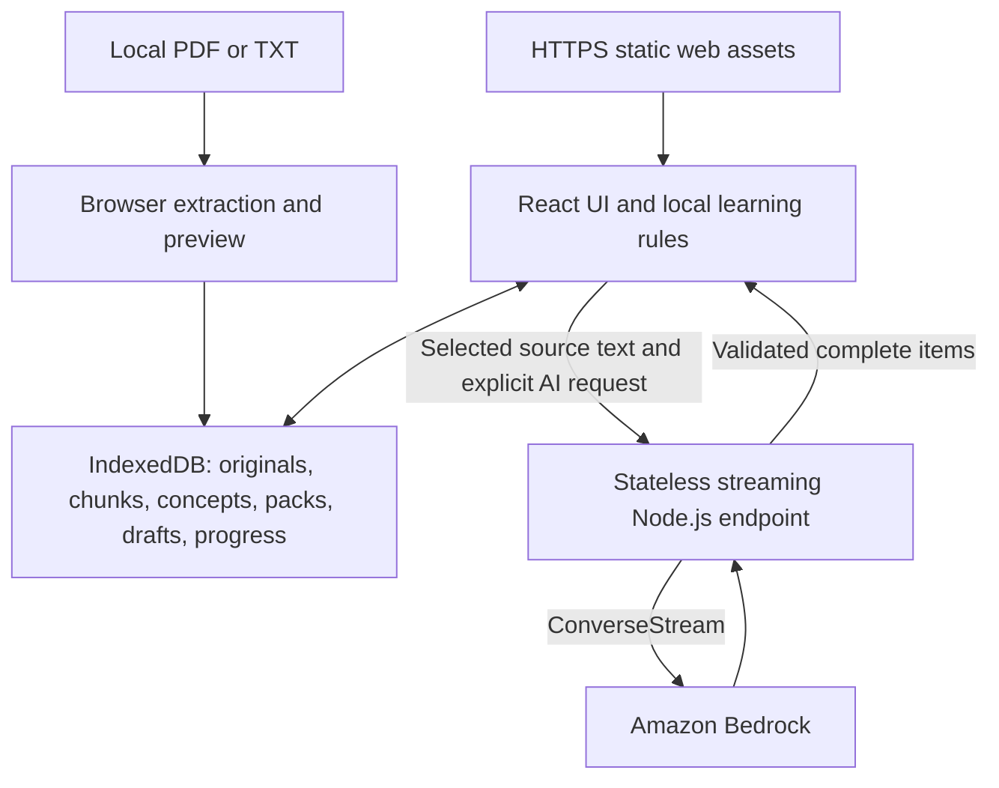

# Local-first architecture

**Scope revision:** full offline mode is deferred to P1. IndexedDB is the canonical store for learner data in P0. The browser owns extraction, persistence and deterministic learning rules; a stateless server handles bounded Bedrock requests. This replaces the earlier server database, retained cloud documents and preparation-job architecture.

## System view

No learner database, cloud document bucket, login/session system, server-side job queue, outbox, or synchronization is needed. Static web hosting may use S3/CloudFront for application assets only; it must not store learner materials. The server uses temporary request memory, does not cache learner responses, and does not log request/response bodies.

## Responsibilities

| Boundary | Responsibilities |
| --- | --- |
| Browser ingestion | Check PDF/TXT bytes, configured 10 MB and 50-page limits, decode/extract text, preview limitations, retain original locally |
| Browser learning domain | Exact MCQ grading, numeric final-answer checks (tolerance/units against reviewed keys), attempts, flags, session budgets, evidence labels, review dates and return flow |
| Math rendering | Safe KaTeX rendering of model-written LaTeX with accessible fallback; generated math is never evaluated |
| IndexedDB adapter | Canonical originals, chunks, concepts, self-contained packs, answer drafts, attempts, sessions and progress; schema migrations and transactional writes |
| Stateless AI endpoint | Validate bounded request schemas, choose server-configured model/prompt, invoke Bedrock, validate completed output items, stream sanitized result events |
| Bedrock adapter | Read/write/grade/follow-up tasks: concepts; recall, MCQ, explain, scenario and calculation questions; hints and alternate explanations; rubric feedback on free text and working |
| Resource catalog | Small bundled catalog of checked free links and metadata, matched locally; external navigation only by learner action |

Local extraction may use a dedicated Web Worker to keep the UI responsive. That is a parsing thread, not a service worker or background server job. Keep selected-section retrieval local and simple; add embeddings only if evidence demonstrates the need.

## Ingestion and request flow

1. Learner creates a device-local space and selects a PDF/TXT. Display format/size/page and browser-storage limitations. Files stay on the device.
2. Parse and validate locally; retain the original Blob and page-aware chunks with stable IDs, offsets and revision. Preview extracted text and flag scanned, encrypted, unreadable, unsupported-language or lossy content before generation.
3. Learner selects readable sections/concepts. Before the first online processing request, disclose that selected excerpts and submitted answers go through the configured AI service.
4. Send bounded excerpts, source IDs, concept selection and task metadata, not the PDF or whole document. Initial proposed ceilings: 16 KiB of selected source text and 64 KiB for the complete JSON request, with token/output limits configured separately. Measure and adjust in M0; these are planning limits, not observed payload sizes.
5. Server validates request length/schema and task type, rejects arbitrary model IDs, URLs and user-supplied system instructions, then calls the selected Bedrock model. Browser-side checks are not a security boundary for the endpoint.
6. Server validates generated source IDs against supplied excerpts. Browser additionally checks IDs, excerpts and source revision against canonical local data before saving or rendering. Traceability is not external factual verification.

The server cannot verify page count or file size of a PDF it never receives; those checks belong to local ingestion. Its limits protect submitted text/token use. The endpoint must not fetch URLs or file paths from requests.

## Teaching pipeline

The LLM does the teaching work; the application supplies memory, grounding and structure. Use a fixed pipeline of server-owned task kinds, each with a schema, source-ID validation and input/output limits. This is not an autonomous agent: the application decides which stage runs and when.

| Stage | Task kind | When it runs | Output |
| --- | --- | --- | --- |
| Read | `concepts` | Once per selected section | Concepts with descriptions and source IDs |
| Write | `pack` | Per 3–5 question pack, plus at most one prefetch | Mixed recall, MCQ, explain, scenario and calculation items with keys/rubrics, explanations and source IDs |
| Grade | `grade` | Only for explain, scenario and calculation working | Supported/missing elements, rubric outcome or `uncertain`, source references |
| Follow-up | `followup`, `hint`, `explain_again` | After an incorrect/uncertain result, or on learner request | One targeted question, a hint, or an alternate explanation |

MCQ choices and numeric final answers are checked locally and never call the model. For calculation items, the final number is compared against the reviewed key with configured tolerance and allow-listed units; the model grades only the working, and the two outcomes are stored separately. A correct number with flawed or uncertain working does not advance reasoning-based progress.

PDF text extraction can garble notation. Generate calculation items only from sections whose extracted symbols pass a basic readability check or that the learner has corrected; otherwise show the limitation. Sending page-image crops to a vision-capable model is an optional gated experiment (consent, data cost, measured quality), not P0.

## Packs and streaming

A pack is one versioned, self-contained JSON object with pack ID, material revision, selected concepts, model/prompt/schema versions, 3–5 questions, answers or rubrics, explanations, source IDs and excerpts. Source excerpts needed for feedback travel with the pack; no server lookup is required. Preserve the PRD's minimum three questions across two selected concepts when sufficient material exists.

Use `ConverseStream` only with a verified streaming-capable model and transport. Decode bounded incremental output into complete item records, validate each item, then send typed `item`, `complete` or `error` events. Do not render raw partial JSON, reveal answer tokens, or claim a complete pack before cross-item checks pass. Persist each usable item locally; finalize the canonical pack object after completeness and coverage checks. Partial generation is visibly incomplete and does not satisfy the minimum-pack acceptance gate.

A first complete validated question may appear before the rest of the pack. Measure time to that question separately from full-pack completion. If streaming quality or framing fails, a bounded non-streamed small-pack fallback is acceptable with explicit loading state; do not claim streaming latency benefits without measurements. [Bedrock ConverseStream](https://docs.aws.amazon.com/bedrock/latest/APIReference/API_runtime_ConverseStream.html).

Keep at most one next-pack pre-generation request active and one unused prefetched pack per session. Start only while the learner is actively using the current pack, with known next concepts and remaining budget; skip unnecessary work and cancel on topic change, deletion or session end. This is a live browser request, not a queue or reconnection task. Prefetch must not increase the context/response caps or bypass provider spending controls.

## Canonical local data and failure resilience

All nine PRD entities live locally: StudySpace, Material, SourceChunk, Concept, Activity, Attempt, ConceptProgress, Session and Resource. Use stable IDs, schema versions and material revisions. Store original Blobs and chunks separately from pack JSON to avoid duplicating the whole source. No server owner/session ID is required.

Persist an answer draft before starting free-text grading. A failed or interrupted request leaves it available for the learner's explicit retry; it is not queued for later grading. Do not auto-submit on reconnect or reload. A retry can incur another provider charge: a stateless endpoint cannot guarantee exactly-once inference after an ambiguous timeout.

Commit attempts and their progress projection transactionally before showing completion. Stable local attempt IDs prevent double-clicks or repeated responses from duplicating evidence. MCQs are graded locally; free-text model feedback is requested online. On local storage failure retain the answer in memory, report that persistence failed and offer retry. No system can promise durable recovery after browser eviction, clearing storage, or closing before a failed save succeeds.

Local reads avoid server round trips but still have device/parse/render costs. Measure them; do not label all reads instantaneous. Normal page reload persistence remains required when the application can load. Networkless application launch/reload is not a P0 guarantee, and no offline-specific UI is introduced.

## Deletion and late responses

Delete a space's original, chunks, concepts, packs, drafts, attempts and progress in local transactions; clear-all removes every application-owned local record. Cancel active generation/grading and clear related in-memory state. Each callback must check the space still exists and its request/material generation matches before writing, including after another tab deletes it. A stale response must never recreate a space.

There is no remote learner-data delete endpoint or pending-delete queue. Deleting local data does not retract a request already sent to a provider; disclose processing boundaries without promising control over provider systems. Same-origin browser data is not account-isolated: explain shared-device access and that clearing browser data permanently loses progress and originals.

## Hosting and endpoint controls

Use a stateless Node.js service locally. The preferred AWS hosting candidate is a streaming Lambda Function URL, optionally behind CloudFront for HTTPS routing; confirm streaming support, proxy buffering, request timeout and cancellation end to end in M0. Avoid putting this design behind an unverified buffered HTTP integration. [Lambda streaming tutorial](https://docs.aws.amazon.com/lambda/latest/dg/response-streaming-tutorial.html).

AWS credentials stay in the server's execution role, never browser code. No learner login/auth database is introduced. A paid public AI endpoint still needs server-enforced payload/output/time/concurrency limits, platform request-rate controls and an operator disable switch. CORS is not authentication or spend protection. Keep the first demo limited until deployment-level abuse controls are verified. Stateless per-request checks and billing alerts are not a global hard dollar cap.

AI routes use no-store responses; proxies and logs must not cache or record learner payloads. Allow only supported task kinds (concepts, pack, grade, followup, hint, explain_again, practical task), with server-owned prompts and bounded request context. Return request IDs and recoverable errors without persisting content. Measure first-question latency, complete-pack latency, bytes transferred and unused-prefetch cost.

## Future extension boundary

Self-contained packs keep P1 full offline support feasible without changing the learning domain. A later service worker/pinning design still needs cache updates, storage eviction, reload compatibility, accessibility and device testing; do not promise it is a one-day task. It is not part of this P0 architecture or acceptance gate.
